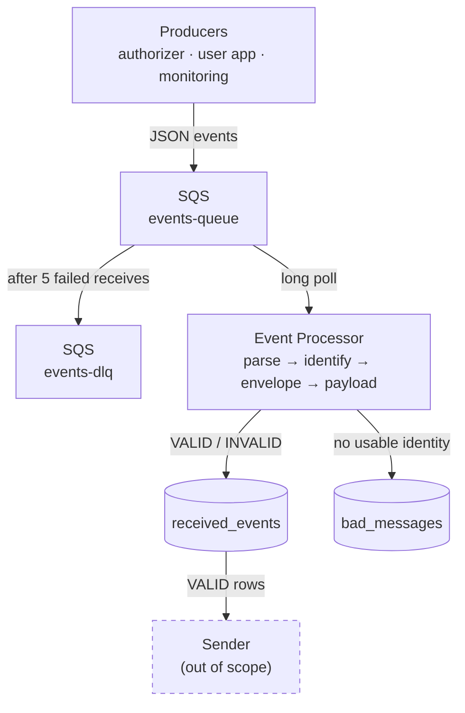

# Design

## Overview

Lots of internal systems produce events: the transaction authorizer, user-facing apps, monitoring, various integrations. Each event belongs to a tenant (a client) who eventually needs to get it, and producers shouldn't have to care how delivery to each client works.

This service sits in the middle. It reads events off a queue, checks them against a contract, decides whether they're deliverable, and stores them so a separate Sender can pick them up. The Sender itself is out of scope.

The main things it has to get right:

- don't lose events, and don't drop anything silently, even broken ones
- processing the same event twice shouldn't create a second record
- a message that keeps failing shouldn't loop forever
- stopping the service shouldn't lose whatever it was working on

The case left a few things open, so I made these assumptions:

- No throughput or latency targets, so I went for correctness and simplicity over speed.
- I don't know how producers behave on retries (same `event_id`? do they ever send corrections?), so duplicate handling is picked to be safe either way. More on that below.
- Single currency (USD), amounts in integer cents.
- All times are UTC. `occurred_at` has to include a timezone, e.g. `2026-10-24T10:05:00Z`, otherwise the event is INVALID.
- Routing is by tenant, one tenant, one destination.
- The Sender reads from the database, not the queue.

## Architecture



Producers put JSON on `events-queue`. The processor long-polls it, validates each message and writes it to one of two tables: anything it can identify goes into `received_events` (VALID or INVALID), anything it can't goes into `bad_messages`. If processing itself keeps failing, SQS moves the message to `events-dlq` after 5 tries.

Locally it's all Docker Compose: LocalStack for SQS, Postgres, the processor, plus a small producer script for test data.

### Events

Every event shares the same envelope:

```json
{
  "event_id": "8b2e4d1f-6a3c-4f9b-b2e7-0c9d1a3f6e22",
  "event_type": "card.blocked",
  "schema_version": "1",
  "tenant_id": "bank-b",
  "occurred_at": "2026-10-24T10:05:00Z",
  "payload": { "card_id": "card-9", "reason": "STOLEN" }
}
```

`event_id` is the idempotency key, `event_type` + `schema_version` pick the payload schema, and `tenant_id` is who the event belongs to (and who the Sender delivers it to).

I defined three event types, one per kind of producer: `transaction.authorized` from the authorizer (`account_id`, `amount`), `card.blocked` from the user app (`card_id`, `reason` of LOST or STOLEN), and `spend.threshold_exceeded` from monitoring (`account_id`, `amount`, `threshold`). Amounts are ints ≥ 1.

The processor doesn't apply any business rules. Deciding whether spend crossed a threshold is the monitoring producer's job; the processor only checks that the event matches its contract.

Schemas are just files:

```
schemas/
  envelope.json
  transaction.authorized/v1.json
  card.blocked/v1.json
  spend.threshold_exceeded/v1.json
```

They load once at startup, and a broken schema file stops the service from starting. It's better to catch that at deploy time than on the first message. `event_type` deliberately isn't an enum: the supported types are whatever schema files exist, so adding a type means adding a file and nothing else. An unknown type or version (`card.exploded`, or `card.blocked` v9) gets through the envelope check, finds no schema, and is stored as INVALID with `No schema for card.exploded v1`.

Extra payload fields are allowed. Strict validation would catch more mistakes, but every additive change would then need a coordinated deploy with the producer.

### What happens to a message

In order: parse it, make sure it has an identity (a `tenant_id` and a UUID `event_id`), check the envelope, check the payload against its schema, write it, and only then delete it from SQS.

| Message | Ends up in | Deleted from the queue? |
|---|---|---|
| passes everything | `received_events`, VALID | yes |
| envelope or payload broken, or no schema for it | `received_events`, INVALID with the errors | yes |
| not JSON, not an object, no `tenant_id`, `event_id` not a UUID | `bad_messages` | yes |
| `(tenant_id, event_id)` already stored | nothing new, logged as a duplicate | yes |
| processing throws (DB down etc.) | nowhere yet | no, SQS redelivers it; after 5 tries it goes to the DLQ |

So everything ends up either in a table or in the DLQ.

### Tables

The full SQL is in `db/events.sql`. In summary:

`received_events` has the envelope fields, the payload as JSONB, a `status`, the validation `errors` as JSONB, and `loaded_at`. The primary key is `(tenant_id, event_id)`, which is what makes writes idempotent, and it also means event IDs only have to be unique within a tenant. Most other columns are nullable because an INVALID event might be missing them. There's a partial index on `loaded_at WHERE status = 'VALID'` so the Sender can find new deliverable rows without scanning the invalid ones.

`status` is VALID or INVALID, enforced with a CHECK constraint rather than a Postgres ENUM. The Sender will probably want its own statuses at some point, and a CHECK is easier to change.

`bad_messages` is just `body_hash` (SHA-256, primary key), `raw_body`, `error` and `loaded_at`.

## Decisions

### SQS over Kafka

This was the most significant decision. The case has a single consumer, and the Sender reads from the DB rather than the stream, so most of what Kafka is good at (multiple consumer groups, replay, per-partition ordering) doesn't add much here.

What SQS gives me out of the box mattered more. Poison messages are handled through configuration: with a redrive policy and `maxReceiveCount`, SQS moves them to a DLQ on its own, whereas with Kafka I would have to build retry topics and a DLQ myself. Acknowledgement is also per message. I delete a message only once it's saved, and one stuck message doesn't hold up the rest. With Kafka's per-partition offsets, if message 3 keeps failing I can't commit message 5.

If the raw stream ever needs several independent readers, replay, or very high sustained throughput, Kafka becomes the better pick. If we need per-tenant ordering, a FIFO queue with `MessageGroupId = tenant_id` would handle it without switching.

(LocalStack is pinned to 4.12 because newer versions want an auth token, and I didn't want reviewers to need an account.)

### Postgres

Idempotent inserts through the primary key, real SQL when I need to dig into what happened, partial indexes, and a simple local setup. DynamoDB was the other option I looked at seriously. Conditional puts would cover idempotency and Streams would give the Sender a push-based handoff, but debugging is basically limited to key lookups, and for this scope Postgres is simpler to run and reason about.

### Python

I chose Python because it's what I could deliver fastest and most cleanly in the time available. The work is I/O-bound so speed isn't a concern, and the pieces are small enough that porting to Go later would be straightforward.

### JSON Schema files

Producers already send JSON, a new type or version is a new file, and the validator gives field-level errors I can store as-is. Nothing extra to run. Avro or Protobuf with a proper schema registry would get smaller payloads and enforced compatibility between versions, and that's where I'd go if either becomes a real problem. For now the `schemas/` folder acts as a lightweight registry: versioned files that change through PRs.

### A separate table for unidentifiable messages

If a message can't be parsed, or has no tenant, or its `event_id` isn't a UUID, there's nothing to key it on. To put it in `received_events` I'd have to make the key columns nullable or invent a fake ID, and both weaken the main table. So it goes into `bad_messages`, keyed by a hash of the body. The main table keeps real NOT NULL keys and the Sender never has to skip over unidentifiable rows. This is the standard reject/quarantine table pattern from ETL pipelines.

A single table with nullable identity columns would have been easier to query, but at the cost of integrity.

### Duplicates: first write wins

If a `(tenant_id, event_id)` already exists, the insert is skipped (`ON CONFLICT DO NOTHING`), it's logged as a duplicate, and the message is deleted.

Most duplicates are going to be SQS redeliveries of the exact same message, so skipping is right for those. The tricky case is a producer sending the same ID with a different body. Since I don't know whether that happens, the safer choice is to never overwrite stored data. Since the check is part of the insert, there's no race between instances either. It's the standard idempotent-consumer approach: events are facts, and a correction is a new event with a new ID.

Alternatives I considered:

- last write wins: allows corrections, but a stale copy can overwrite good data, and rows could change after the Sender has already read them
- only overwrite if the stored row is INVALID: lets broken events get fixed, but then one ID means different things at different times
- compare bodies and flag conflicts: catches same-ID-different-body, but needs a stored hash and another status

Any of these can be added later without schema changes once we know how producers actually behave. Until then the contract is: reuse `event_id` on retries, use a new one for corrections.

### Routing and the handoff to the Sender

Routing is just `tenant_id` + `status`: VALID gets delivered to that tenant, INVALID doesn't. I didn't add a routing column since it would just duplicate `tenant_id`, and I'm assuming the Sender maps tenants to endpoints from its own config. If routing ever depends on more than the tenant (per event type, say), a column would make sense then.

For the handoff, the Sender can poll for new VALID rows using the partial index. If that's too slow, `LISTEN/NOTIFY` is the next step: notify after each VALID insert, and the Sender wakes up and queries. The table stays the source of truth because notifications aren't durable. Note that `LISTEN` needs a direct connection, so it won't work through PgBouncer in transaction mode.

### Concurrency

It's a single-threaded loop. Each poll grabs up to 10 messages, handles them in order, and deletes each one once it's saved. A message takes milliseconds and there's no throughput target, so a single sequential consumer is sufficient.

The scaling the case cares about is more producers and more event types, and the schema files cover that. If throughput ever matters, more instances work as-is (SQS spreads messages across them and idempotency absorbs any overlap). Threads inside an instance would come after that.

## Failure handling

Most of the failure handling falls out of one rule: a message only gets deleted after it's been written.

- DB is down: nothing gets deleted, so SQS redelivers after the 30s visibility timeout.
- Crash before the write: same thing, it comes back and gets processed normally.
- Crash after the write but before the delete: it comes back and gets absorbed as a duplicate.
- Processing keeps failing: after 5 receives SQS moves it to `events-dlq`, which keeps messages for 14 days.

INVALID events and bad messages are not poison. They're handled successfully: saved, then deleted. Poison means the processing itself broke.

The catch with 30s × 5 receives is that if the DB is down for more than ~2.5 minutes, healthy messages end up in the DLQ. They can be redriven once the DB is back, but right now nothing alerts on DLQ depth and nothing redrives automatically.

### Graceful shutdown

On `docker compose stop` (or a deploy or scale-down), Docker sends SIGTERM. The handler only sets a stop flag. The loop checks it between messages and between polls, and polls wait at most 5 seconds, so it notices quickly. Whatever message is in progress finishes and gets deleted. Anything received but not started yet is handed back with `ChangeMessageVisibility(0)`, so another instance can pick it up right away instead of waiting out the 30 seconds. Then the DB connection closes and the process exits.

If it takes too long and Docker sends SIGKILL, nothing is lost. Anything not deleted comes back after the timeout, and anything saved but not deleted is absorbed as a duplicate.

The Dockerfile uses the exec form of `CMD`, so Python is PID 1 and actually gets the signal.

## Testing

```
docker compose run --rm --no-deps processor pytest
```

These are unit tests, so nothing else needs to be running. They cover the validator (valid, invalid and bad cases), the consumer with SQS and the store mocked out (valid and invalid events are saved and deleted, bad messages are quarantined, and duplicates are still deleted from the queue), and the schema registry refusing to start with a broken schema.

What's missing is an integration test that pushes the producer's 11 messages through real SQS and Postgres, then checks where each one landed and that both queues are empty afterwards. For now the README walks through doing that by hand.

## Limitations and next steps

Known limitations:

- Single currency. Multi-currency would need an ISO-4217 code and per-currency minor units.
- Same-ID-different-body isn't detected.
- New schemas need a restart.
- No compatibility checks between schema versions.
- Any non-empty `tenant_id` is accepted; there's no allowlist.
- No check for timestamps far in the future.
- Logs only, no metrics.

In priority order, I'd add the integration test first, then metrics (processed, invalid, bad, duplicate and failed counts, latency, DLQ depth) with an alert on the DLQ, since that's the most significant gap for production. After that, `LISTEN/NOTIFY` for the Sender and exponential backoff on retries via `ChangeMessageVisibility`. Concurrency inside an instance, Avro/Protobuf and a tenant registry would only be worth adding once there's a concrete need.
